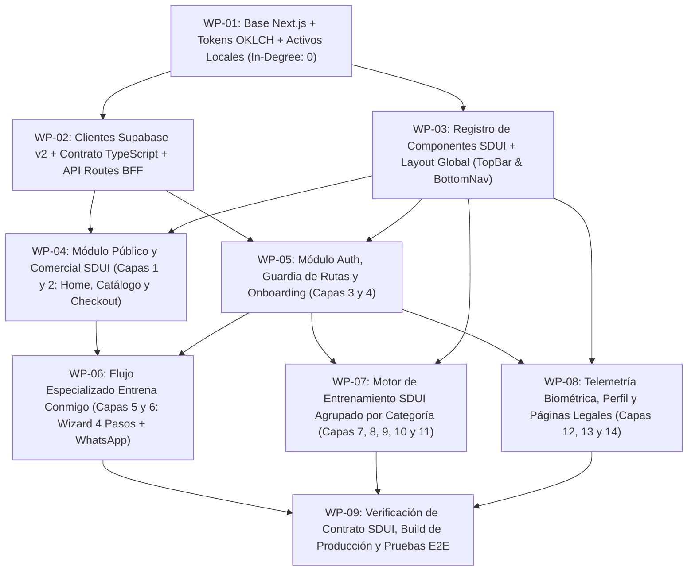

# Plan de Ejecución: WBS y DAG Topológico — VTeamFit App MVP 2026

> **Metodología:** Estructura de Desglose del Trabajo (WBS — Regla del 100%, Exclusividad Mutua y Diccionario WBS) + Grafo Acíclico Dirigido (DAG con Ordenamiento Topológico de Kahn), según [D10: Estudio Sobre División De Tareas.md](file:///C:/00_dossiers_investigacion/Estudio%20Sobre%20Divisi%C3%B3n%20De%20Tareas.md#L44-L94).  
> **Anclado a:** [PRD.md v1.1](file:///C:/Users/matil/.gemini/antigravity/scratch/Vteamfit%20App%20MVP%202026/PRD.md) y [01_DESIGN.md](file:///C:/Users/matil/.gemini/antigravity/scratch/Vteamfit%20App%20MVP%202026/extraccion_visual/01_DESIGN.md).

---

## 1. Grafo Acíclico Dirigido (DAG) y Ordenamiento Topológico

### Niveles de Ejecución Topológica (Algoritmo de Kahn)
- **Nivel 0 (Arranque / `In-Degree = 0`):** `WP-01` (Base del proyecto, tokens CSS en espacio OKLCH y copiado de activos desde `extraccion_visual/Fotos/`).
- **Nivel 1 (Paralelizable):** `WP-02` (Contratos TypeScript `v2`, cliente Supabase y endpoints BFF) $\parallel$ `WP-03` (Registro de Componentes SDUI y navegación global).
- **Nivel 2 (Paralelizable):** `WP-04` (Capas 1 y 2: Landing y Checkout SDUI) $\parallel$ `WP-05` (Capas 3 y 4: Auth, Guardia sin plan y Onboarding).
- **Nivel 3 (Paralelizable):** `WP-06` (Capas 5 y 6: Entrena Conmigo) $\parallel$ `WP-07` (Capas 7–11: Dashboard, Semanas, Día agrupado por `category`, Reproductor y Éxito) $\parallel$ `WP-08` (Capas 12–14: Stats, Perfil, Políticas y Soporte).
- **Nivel 4 (Cierre / Ruta Crítica Final):** `WP-09` (Auditoría de la Regla del 100% contra `PRD.md` y compilación limpia).

---

## 2. Diccionario WBS (Paquetes de Trabajo y Criterios de Aceptación Binarios)

| Código WBS | Paquete de Trabajo | Fronteras y Alcance (100% Exclusivo) | Dependencias | Criterios de Aceptación Binarios (Pass/Fail) |
| :--- | :--- | :--- | :--- | :--- |
| **`WP-01`** | **Inicialización, Tokens OKLCH y Activos** | Inicializar app Next.js en el workspace, configurar variables CSS OKLCH de `01_DESIGN.md`, tipografía `Outfit` y migrar activos desde `extraccion_visual/Fotos/` hacia `public/images/`. | Ninguna (`In-Degree: 0`) | 1. Todos los tokens OKLCH y `carbon-texture-v4.webp` cargan sin 404. 2. Las 17 fotos y `logo.svg` existen en `public/images/`. |
| **`WP-02`** | **Capa de Datos `v2`, Contratos TS y BFF APIs** | Clientes Supabase apuntando a `db: { schema: 'v2' }`, tipos estrictos (`PlanSDUI`, `WorkoutDaySDUI`, `ExerciseItemSDUI`) y endpoints `/api/coupons/validate`, `/api/enrollments`, `/api/profile`, `/api/auth/register`. | `WP-01` | 1. Cero archivos de catálogo estático (`plans-catalog.ts` prohibido). 2. `/api/coupons/validate` valida contra `v2.coupons` sin filtrar códigos al cliente. |
| **`WP-03`** | **Registro de Componentes SDUI y Navegación** | Componentes finitos del registro (`PlanCardSDUI`, `PlanBadgeSDUI`, `CategoryExerciseGroup`, `ExerciseCardSDUI`, `DayCardSDUI`), `TopBar` reactivo a sesión y `BottomNav`. | `WP-01` | 1. Cada componente tiene fallback seguro ante propiedades nulas/desconocidas. 2. `CategoryExerciseGroup` agrupa ejercicios por `category` respetando `order`. |
| **`WP-04`** | **Módulo Público y Checkout SDUI (Capas 1 y 2)** | Landing (`/`) con los 5 planes en orden `display_order` (`1..5`), vista de detalle (`/planes/[slug]`), validación de cupón en servidor y botón `COMPRAR PLAN` dual. | `WP-02`, `WP-03` | 1. Los 5 planes se pintan desde `v2.plans` en orden 1 a 5. 2. Si no hay sesión, `COMPRAR PLAN` lleva a `/registro?plan=[slug]` sin activar el plan aún. |
| **`WP-05`** | **Autenticación, Guardia de Plan y Onboarding (Capas 3 y 4)** | Pantallas `/login`, `/registro`, `/recuperar` y `/onboarding` (género, peso, altura, edad). Guardia de ruta para usuarios sin plan activo. | `WP-02`, `WP-03` | 1. Login sin plan activo en `v2.user_enrollments` redirige a `/#planes`. 2. Registro libre termina `/onboarding` y va a `/#planes`; con `?plan=[slug]` vuelve a `/planes/[slug]`. |
| **`WP-06`** | **Flujo Especializado Entrena Conmigo (Capas 5 y 6)** | Wizard de 4 pasos (`/dashboard/entrena-conmigo/onboarding`) y pantalla de espera (`/dashboard/entrena-conmigo/espera`). | `WP-04`, `WP-05` | 1. Guarda las 4 respuestas en `v2.user_enrollments.onboarding_data`. 2. Si ya tiene `onboarding_data`, salta directo a `/espera` y arma el link de WhatsApp usando `ui_config.whatsapp_phone`. |
| **`WP-07`** | **Motor de Entrenamiento SDUI (Capas 7, 8, 9, 10 y 11)** | `/dashboard` (con selector de planes y estado vacío si `0` filas en `v2.plan_workouts`), `/semana/[week]`, `/dia/[day]` agrupado por `category`, `/ejercicio/[slug]` con guardado progresivo y `/exito`. | `WP-03`, `WP-05` | 1. Planes con `0` sesiones muestran `"No hay semanas disponibles aún."`. 2. `GUARDAR Y CONTINUAR` guarda en `exercise_logs` con `completed_at = NULL`. 3. `COMPLETAR DÍA` sella `completed_at = now()`. |
| **`WP-08`** | **Estadísticas, Perfil y Legales (Capas 12, 13 y 14)** | `/dashboard/stats` (anillo, racha de días con `completed_at IS NOT NULL`, gráfica y modal de peso en `v2.user_weight_logs`), `/dashboard/perfil`, `/politicas` y `/soporte`. | `WP-03`, `WP-05` | 1. Solo días con `completed_at IS NOT NULL` suman al % y racha. 2. El modal de peso inserta en `v2.user_weight_logs` y actualiza `v2.user_profiles.weight_kg`. |
| **`WP-09`** | **Verificación de Contrato y Build de Producción** | Auditoría ascendente de las 14 capas contra `PRD.md`, `01_DESIGN.md` y `02_TEXTOS.md`, `npm run build` sin errores y prueba funcional en vivo. | `WP-06`, `WP-07`, `WP-08` | 1. `npm run build` sale con código `0`. 2. Las 14 capas responden `200 OK` conectadas a Supabase `v2`. |
