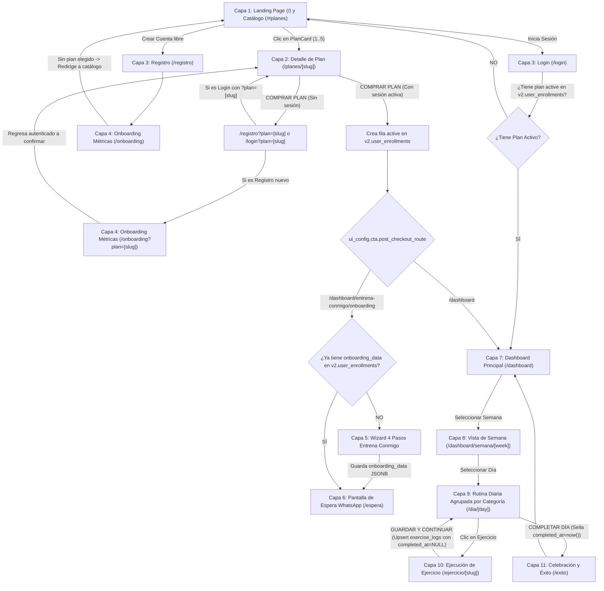

# PRD — VTeamFit App MVP 2026 (Arquitectura SDUI + KISS)

> **Estado:** Especificación Anclada v1.1 (Validada con `/grill-me`)  
> **Esquema de Base de Datos:** Supabase `v2` (`https://sfbsizxoxyjfancssfbb.supabase.co` — prohibido modificar `public`)  
> **Documentos Visuales Vinculantes:**  
> - [01_DESIGN.md](file:///C:/Users/matil/.gemini/antigravity/scratch/Vteamfit%20App%20MVP%202026/extraccion_visual/01_DESIGN.md) (Tokens OKLCH, Tipometría y 14 Capas de UI)  
> - [02_TEXTOS.md](file:///C:/Users/matil/.gemini/antigravity/scratch/Vteamfit%20App%20MVP%202026/extraccion_visual/02_TEXTOS.md) (Copywriting oficial, estados y validaciones)  
> - [03_FOTOS.md](file:///C:/Users/matil/.gemini/antigravity/scratch/Vteamfit%20App%20MVP%202026/extraccion_visual/03_FOTOS.md) (Activos locales en `extraccion_visual/Fotos/` y CDN de video)  

---

## 1. Visión y Principios Arquitectónicos (KISS + SDUI)

1. **Server-Driven UI (SDUI) Focalizado:**
   - El frontend actúa como un motor de renderizado con un **Registro de Componentes cerrado y finito**.
   - Ningún plan comercial, precio, orden de visualización, cupón de descuento, insignia, número de WhatsApp, metodología, rutina diaria, orden de ejercicio ni ruta de video está *hardcodeado* en el cliente: todo proviene del esquema `v2` de Supabase.
2. **Principio KISS y Cero Mock Data:**
   - **100% fiel a la Base de Datos:** Si un plan tiene `0` sesiones en `v2.plan_workouts`, el dashboard muestra `"No hay semanas disponibles aún."` sin inventar rutinas falsas.
   - **Separación estricta entre Autenticación y Compra:** Registrarse (`/registro`) o iniciar sesión (`/login`) **jamás** activa un plan automáticamente. La única acción que escribe en `v2.user_enrollments` es el botón **`COMPRAR PLAN`** en `/planes/[slug]` con sesión iniciada.
   - **Agrupación por Categoría Nativa:** En la vista de rutina diaria, el frontend agrupa y renderiza los bloques de ejercicios directamente por la propiedad `category` de cada ejercicio, respetando su `order`.

---

## 2. Fuente de la Verdad: Las 8 Tablas del Esquema `v2`

| Tabla en `v2` | Rol en el Producto | Columnas Clave e Inyección SDUI |
| :--- | :--- | :--- |
| **`v2.plans`** | Catálogo de los 5 programas oficiales | `id`, `name`, `slug`, `description`, `tagline`, `total_weeks`, `days_per_week`, `cover_image_url`, `is_published`, `display_order` (`1..5`), `price_amount`, `compare_at_price`, `currency`, `billing_type`, `ui_config` (`jsonb`, incluye `whatsapp_phone` en `entrena_conmigo`). |
| **`v2.coupons`** | Códigos de descuento gestionables | `id`, `code` (único), `discount_percent` (`1..100`), `is_active`, `plan_id` (nullable: `NULL` aplica a todos los planes). Validados vía backend para no exponer códigos en el navegador. |
| **`v2.plan_workouts`** | Sesiones diarias por semana y día (137 actuales en `plan_padel`) | `id`, `plan_id`, `week_number`, `day_number` (`1..7`), `day_name` (`LUNES..DOMINGO`), `focus`, `warmup_instructions`, `is_rest_day`, `exercises` (`jsonb` con `order`, `category`, `name`, `video_code`, `video_path`, `series`, `reps`, `rpe`, `notes`). |
| **`v2.exercises`** | Catálogo maestro de 308 ejercicios | `id` (slug), `name`, `category`, `video_code`, `video_path`, `original_physical_file`, `other_acceptable_codes`, `is_home_friendly`, `instructions`. |
| **`v2.user_profiles`** | Perfil extendido y biometría base | `id` (FK `auth.users`), `email`, `full_name`, `avatar_url`, `role` (`student`, `coach`, `admin`), `phone`, `gender`, `age`, `weight_kg`, `height_cm`, `birthdate`, `experience_level`. |
| **`v2.user_enrollments`** | Planes activos adquiridos por el usuario | `id`, `user_id`, `plan_id`, `start_date`, `current_week`, `status` (`active`, `paused`, `completed`), `onboarding_data` (`jsonb` para persistir las 4 respuestas de *Entrena Conmigo*). |
| **`v2.user_workout_logs`** | Telemetría progresiva de sesiones y cargas | `id`, `user_id`, `plan_id`, `workout_id`, `week_number`, `day_name`, `completed_at` (`NULL` = en progreso; `NOT NULL` = día completado), `duration_seconds`, `perceived_effort`, `notes`, `exercise_logs` (`jsonb`). |
| **`v2.user_weight_logs`** | Historial de pesaje biométrico | `id`, `user_id`, `recorded_date`, `weight_kg`. |

---

## 3. Mapa de Flujos de Usuario (Validado)

---

## 4. Reglas de Negocio y Decisiones de Diseño Ancladas

### 4.1. Regla de Acceso sin Plan Activo (Guardia de Rutas)
- Si un usuario inicia sesión en `/login` (sin venir de `?plan=[slug]`) y **no posee ningún plan con `status = 'active'` en `v2.user_enrollments`** (y su rol no es `admin`/`coach`), el sistema lo redirige automáticamente a **`/#planes`** para que elija y adquiera un plan.
- Del mismo modo, si un usuario sin plan activo intenta navegar manualmente a `/dashboard`, es redirigido a `/#planes`.
- En la barra superior (`TopBar`) de la Home (`/`), si el usuario ya tiene sesión iniciada verá su estado de cuenta (y botón para ir a `/dashboard` si tiene plan activo, o `CERRAR SESIÓN` si aún está eligiendo plan).

### 4.2. Registro Libre vs. Registro desde un Plan (`/registro` y `/onboarding`)
- **Registro Libre (`/registro`):** Está permitido registrarse sin haber elegido un plan. Al crear la cuenta, pasa por `/onboarding` (Capa 4: Género en `v2.user_profiles.gender`, Peso/Altura/Edad en `v2.user_profiles` + primer pesaje en `v2.user_weight_logs`) y al finalizar es enviado a **`/#planes`** con su sesión iniciada.
- **Registro o Login desde un Plan (`/registro?plan=[slug]` o `/login?plan=[slug]`):**
  - Ni el registro ni el login activan el plan silenciosamente.
  - Tras autenticarse (y completar `/onboarding` si es cuenta nueva), el sistema **devuelve al usuario a `/planes/[slug]`** ya con la sesión iniciada para que confirme la operación pulsando **`COMPRAR PLAN`**.

### 4.3. Checkout Dual y Cupones en `/planes/[slug]` (Capa 2)
- **Validación de Cupones (`v2.coupons`):** El campo `¿Tienes un código de descuento?` consulta un endpoint de servidor (`/api/coupons/validate`) que verifica `v2.coupons` (`is_active = true` y `plan_id IS NULL OR plan_id = :planId`). Ningún código se expone en el cliente.
- **Botón `COMPRAR PLAN`:**
  - Si aplica un cupón de `100% OFF`, muestra `GRATIS` y activa el plan directamente en `v2.user_enrollments`.
  - Si tiene importe a pagar (`> $0`), en esta etapa MVP ejecuta una compra autorizada simulada en un clic que inserta la inscripción en `v2.user_enrollments` (dejando aislado el punto de integración para PayPal/Stripe).
  - Una vez inscrito, redirige a la ruta definida en `v2.plans.ui_config.cta.post_checkout_route`.

### 4.4. Selector de Plan Activo y Planes con 0 Sesiones en `/dashboard` (Capa 7)
- **Selector de Plan (`Spotlight Card`):**
  - Si el alumno tiene `> 1` plan activo en `v2.user_enrollments`, se habilita el selector desplegable para alternar entre sus planes adquiridos.
  - Si el usuario tiene `role IN ('admin', 'coach')` en `v2.user_profiles`, el selector le permite alternar libremente entre los **5 planes oficiales** del catálogo para auditoría y pruebas.
- **Fidelidad Estricta a `v2.plan_workouts` (Cero Mock Data):**
  - El cronograma semanal se construye consultando `v2.plan_workouts` para el `plan_id` activo.
  - Si el plan seleccionado devuelve `0` filas (como ocurre hoy con los planes cuyas sesiones aún no se han subido), se renderiza el estado vacío oficial de [02_TEXTOS.md](file:///C:/Users/matil/.gemini/antigravity/scratch/Vteamfit%20App%20MVP%202026/extraccion_visual/02_TEXTOS.md#L299): **`"No hay semanas disponibles aún."`**.

### 4.5. Flujo Especializado "Entrena Conmigo" (Capas 5 y 6)
- Cuando el plan activo es `entrena_conmigo`:
  - Si `v2.user_enrollments.onboarding_data` es `NULL`, presenta el **Wizard de 4 pasos** (`/dashboard/entrena-conmigo/onboarding`: Objetivo, Frecuencia, Equipamiento, Lesiones).
  - Al pulsar `ENVIAR RESPUESTAS`, guarda el JSON en `v2.user_enrollments.onboarding_data` y redirige a `/dashboard/entrena-conmigo/espera` (Capa 6).
  - Si el alumno vuelve a entrar otro día y `onboarding_data` ya existe, salta directamente a `/dashboard/entrena-conmigo/espera`.
  - El botón **`ESCRIBIR A VICKY POR WHATSAPP`** lee el teléfono desde `v2.plans.ui_config.whatsapp_phone` y abre `https://wa.me/...` con un mensaje pre-armado que incluye las 4 respuestas guardadas en `onboarding_data`.

### 4.6. Guardado Progresivo de Ejercicios y Cierre de Día (Capas 9, 10 y 11)
- **Agrupación por Categoría en Capa 9 (`/dashboard/semana/[week]/dia/[day]`):**
  - Los ejercicios de `v2.plan_workouts.exercises` se agrupan visualmente por su campo `category` (`PISTA`, `VELOCIDAD`, `ESCALERA`, `HOMBROS`, `GLUTEOS`, `CARDIO`, etc.) respetando el `order`.
- **Guardado Progresivo en Capa 10 (`.../ejercicio/[slug]`):**
  - El campo `PESO (KG)` es opcional (por defecto `0` para ejercicios de pista, velocidad o cardio sin carga externa), mientras que `SERIES` y `REPS` son requeridos para confirmar el ejercicio.
  - Cada vez que el atleta pulsa **`GUARDAR Y CONTINUAR`**, se realiza un `UPSERT` en `v2.user_workout_logs` actualizando el mapa JSONB `exercise_logs` con `completed_at = NULL`. Así, si recarga el navegador o cambia de dispositivo a mitad de la rutina, su progreso parcial se conserva intacto.
- **Sellado del Día en Capa 9 $\rightarrow$ Capa 11 (`.../exito`):**
  - Cuando todos los ejercicios del día figuran en `exercise_logs`, se activa el botón inferior **`COMPLETAR DÍA`**.
  - Al presionarlo, se actualiza `completed_at = now()` y `duration_seconds` en `v2.user_workout_logs`, y se navega a la pantalla de celebración (`/exito`).
  - Todas las métricas de progreso (checks verdes en Semana, anillo de porcentaje y racha en `/dashboard/stats`) contabilizan únicamente las filas de `v2.user_workout_logs` donde **`completed_at IS NOT NULL`**.
